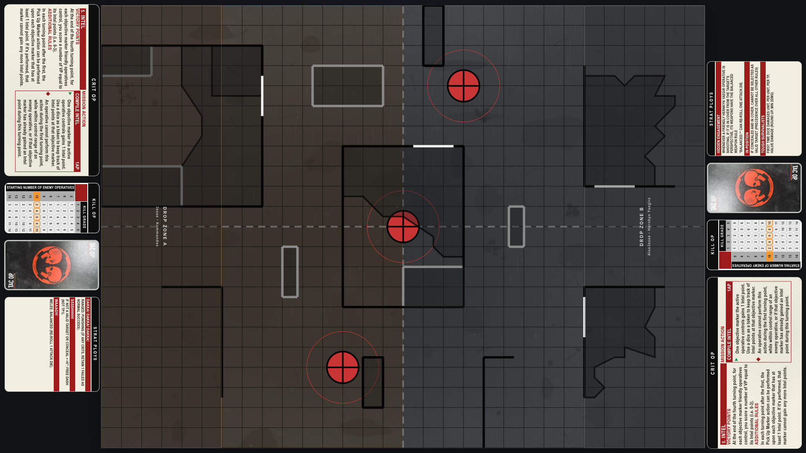
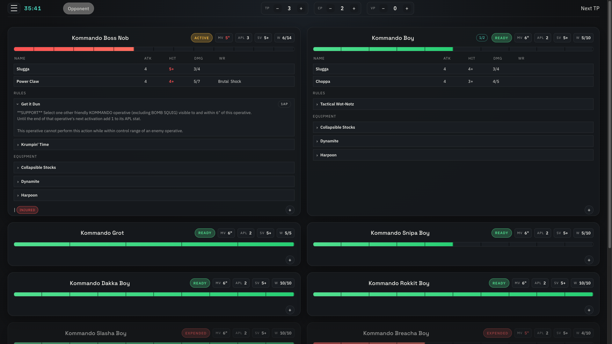
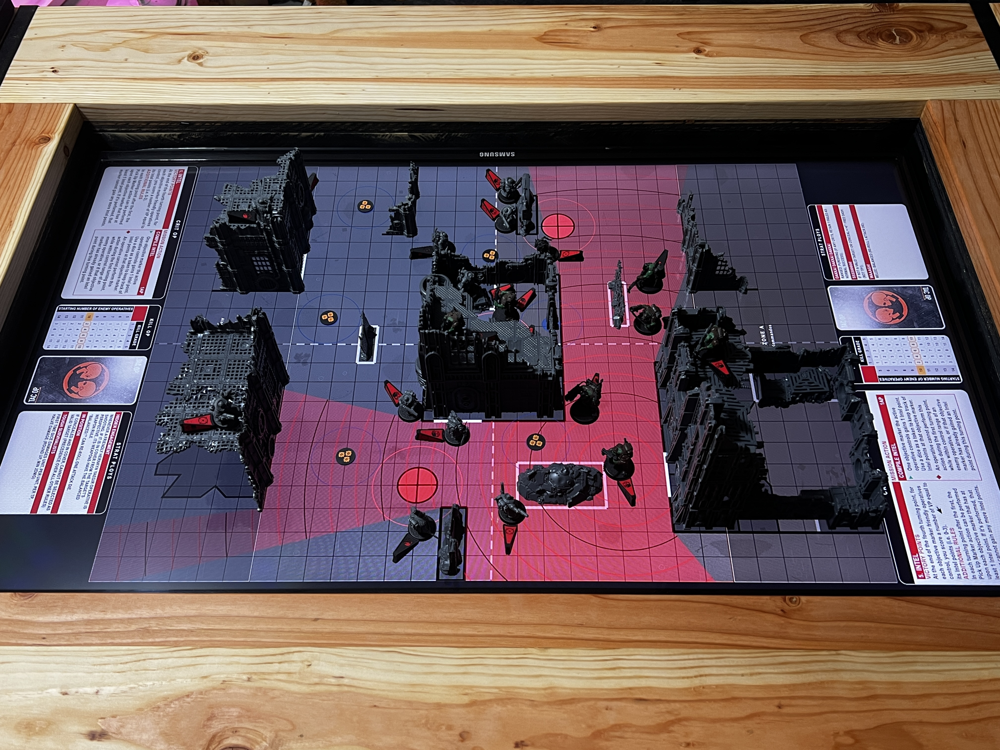
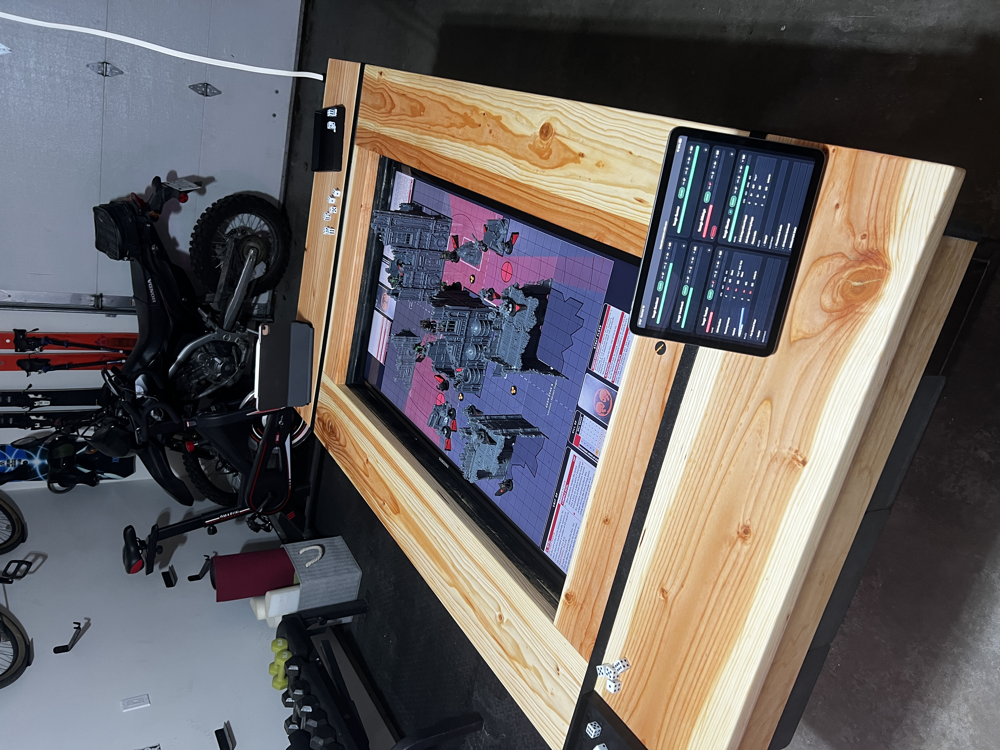

# Kill Team Speedrun Cards

Live site: https://ktspeedrun.jesse-miller.com/

A full-stack React app that turns a dining table into a Kill Team game board. A ceiling-mounted projector shows the killzone, objectives, tokens and live measurements on the table at true scale, while each player uses an iPad for their private roster, ops and controls. Everything runs on the home Wi-Fi from one small Node server.

## Project story

This started as a practical weekend tool so my friends and I could get into games faster. The first goal was simple: reduce setup friction and keep key game info in one place.

As we used it in real matches, new needs kept appearing (lobby sync, board helpers, persistent selections, and smoother flow between setup steps). What began as a quick utility turned into a real software project with iterative feature growth, testing, and architecture decisions driven by actual use.

## Screenshots

### Board setup view



### Player screen



### Live side view



### Board and player screen (live)



## Why this project

Kill Team setup often involves bouncing between rule references, handwritten notes, and memory. This app turns that into a guided, step-by-step flow that helps players learn the sequence, remember what matters at each phase, and see relevant rules when they are actually needed.

By organizing core data (teams, equipment, ops choices, board context, and state) in one place, it reduces rulebook lookup time and cuts down table debate over what happens next. The practical outcome is faster games that follow the rules more accurately, with less interruption and more time spent actually playing.

## Development approach: speed with discipline

I intentionally used AI-assisted development to move quickly on repetitive and exploratory tasks, while keeping engineering standards high.

- Used AI to accelerate drafting, refactors, and test scaffolding.
- Verified behavior manually in-browser and with automated tests.
- Kept features modular across pages, components, and shared state.
- Preserved maintainability with linting, unit tests, and end-to-end tests.
- Treated AI output as a starting point, then reviewed and adjusted for correctness and product fit.

The result is a project that was built fast enough to be useful early, but structured well enough to keep growing.

## Core features

- **Projector table view** (`/table`): the board is warped onto the physical table with a four-corner calibration (keystone + scale), so 1" on screen is 1" on the mat. Per-player side panels show VP/CP, turning point, initiative, active strat ploys, kill op, tac op and the crit op.
- **iPad controllers** (`/play?seat=A|B`): scan a QR code from the projector to take a seat. A seat token keeps the iPad in its seat across reloads and sleep.
- **Map tools on the iPad, shown live on the projector**: multi-leg measuring ruler, line of sight with heavy/light/door wall hits plus obscured/cover hints, operative tokens with range rings, equipment markers and pings. Two-finger pinch zooms the iPad view only.
- **Guided match flow**: lobby → set up the battle (kill teams, killzone, crit op, roll-off, drop zones) → muster (operatives, weapons, equipment, tac op) → deploy (scouting, primary op) → turning points 1–4 → results.
- **Hidden information stays hidden**: the server sends each device only what it may see. Tac ops, primary ops, scouting picks and rosters are revealed at the right moment.
- **Scoring**: crit/kill/tac op VP (max 6 each), plus the primary op bonus revealed at the end.

## Tech stack

- Frontend: React 19, React Router 7, Vite
- Realtime: WebSocket (Node `ws`), one authoritative game state on the server
- Persistence: JSON file on the table computer (survives restarts)
- Quality: Vitest, Testing Library, Playwright, ESLint

## How sync works

The server owns the single game state. Devices send small **actions** (`muster/toggleUnit`, `token/update`, `battle/nextTp`, …), the server applies them with a pure shared reducer (`shared/reducer.js`), saves the result and broadcasts a **role-filtered snapshot** (`shared/views.js`) to the projector and each iPad. Clients hold no game state of their own: a reconnecting device simply receives the latest snapshot. Live tool previews (a ruler being dragged, a sightline) are relayed as ephemeral messages at ~30 Hz and never stored.

## Project structure

- `shared/`: game model, reducer, role views, board geometry and homography (used by server and client).
- `server/`: HTTP + WebSocket table server (`gameServer.js`) and the entry point that serves the built app (`index.js`).
- `src/net/`: the client connection (`GameProvider`).
- `src/board/`: the SVG board renderer shared by the projector and iPads, plus tool overlays.
- `src/table/`: projector page, side panels, calibration, join QR codes.
- `src/play/`: iPad pages: phase steps, map tools, team/rules and opponent tabs.
- `src/rules/`: roster expansion, equipment effects, op cards, kill op counts.
- `src/components/`: unit card, crit op card, kill op table.
- `src/data/`: static game data.
- `tests/e2e/`: Playwright tests that drive a projector and two iPads together.

## Table setup (permanent install)

1. On the computer connected to the projector (Node 20+): `npm install`, then `npm run table`. This builds the app and starts the server on port 3000. It prints the projector URL.
2. Open `http://<computer-ip>:3000/table` full screen (kiosk mode) on the projector output.
3. Open the ☰ menu → **Calibrate projector**. Drag the four handles onto the corners of the 30" × 22" mat, check the 6" rulers with a tape measure, then **Save**. Calibration is stored on the server, so it survives browser resets.
4. Each player scans their QR code with an iPad on the same Wi-Fi. Use Safari's "Add to Home Screen" for a full-screen app.
5. To start the server automatically, run `npm start` (after one `npm run build`) as a login item or service. The game state lives in `server/data/game.json`.

### Desktop icon (macOS)

Run `zsh launcher/build-app.sh` once to make **Kill Team Table.app** on the Desktop (again if the repo moves). Double-clicking it:

- opens a Terminal window and runs `npm run table` (build, then the server on port 3000), keeping the Mac awake with `caffeinate`;
- copies the server's log to `server/data/table.log`;
- opens `/table` in Chrome kiosk mode on the projector: the first screen that isn't the main one or a Sidecar/AirPlay iPad. To pick another screen, put part of its name (printed in the Terminal) in `launcher/projector-screen.local`;
- only reopens the projector page if the table is already running. Stop `npm run dev` first, since it uses the same port.

Close the Terminal window (or press Ctrl+C) to stop the table. Press Cmd+Q to leave the kiosk window.

## Local development

```bash
npm install
npm run dev
```

This runs Vite (with hot reload, listening on your LAN) and the table server (restarts on changes). Open the printed `Network:` URL: `/table` in one window, `/play?seat=A` and `/play?seat=B` on iPads or in two other windows.

## Environment variables

- `PORT`: table server port (default `3000`). Vite's dev proxy follows it.
- `KT_STATE_FILE`: where game state is saved (default `server/data/game.json`).
- `KT_SERVE_STATIC=0`: WebSocket only, don't serve `dist/` (used in dev).

## Testing

```bash
npm run test:unit
npm run test:e2e
npm run lint
npm run build
```

The e2e suite starts its own isolated server and state file, so it never touches a real game.

## Data attribution

Some data in this repository was adapted from community-maintained JSON sources on GitHub.

- `src/data/kt24_v4.json` source: https://github.com/vjosset/killteamjson
- `src/data/weaponRules.json` source: https://github.com/vjosset/ktdash-v4-public

Each source remains the property of its respective authors. Please review and follow the original license/usage terms for redistributed data.

## Roadmap

- Expand supported content: more armies, rules, equipment, maps, and mission sets.
- Improve accessibility audit coverage (keyboard and ARIA refinements).
- Add CI workflow for lint, unit tests, and e2e smoke tests.

## License

Project source code is licensed under the MIT License. See `LICENSE`.

Third-party data files are attributed in `THIRD_PARTY_NOTICES.md` and remain subject to their original source terms.
